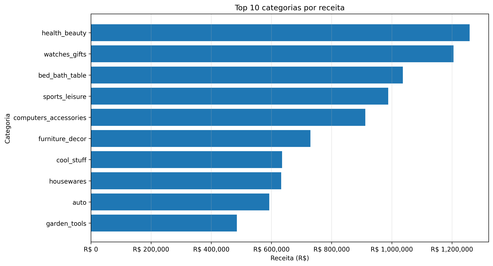
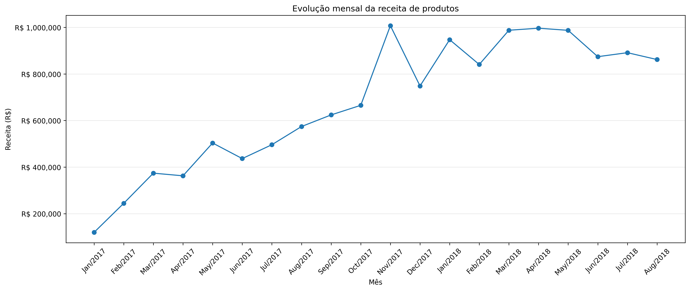
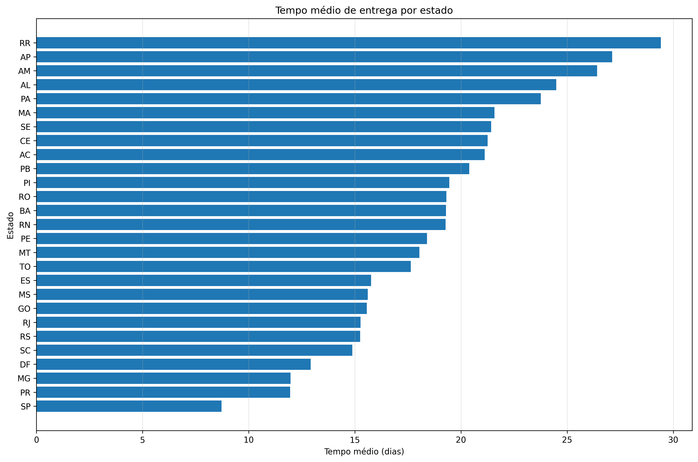
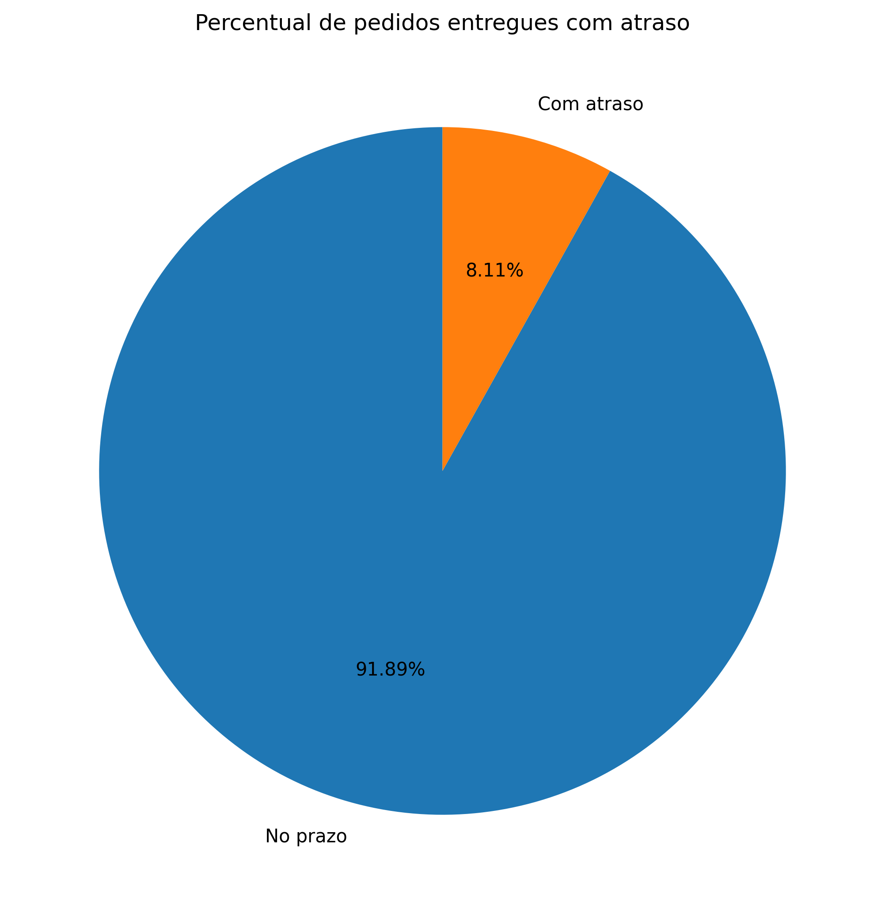
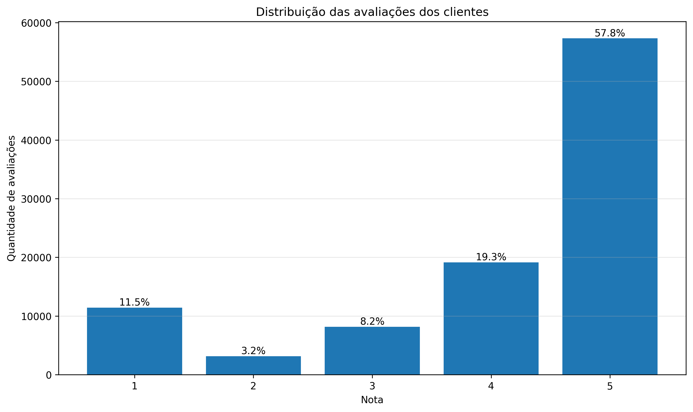
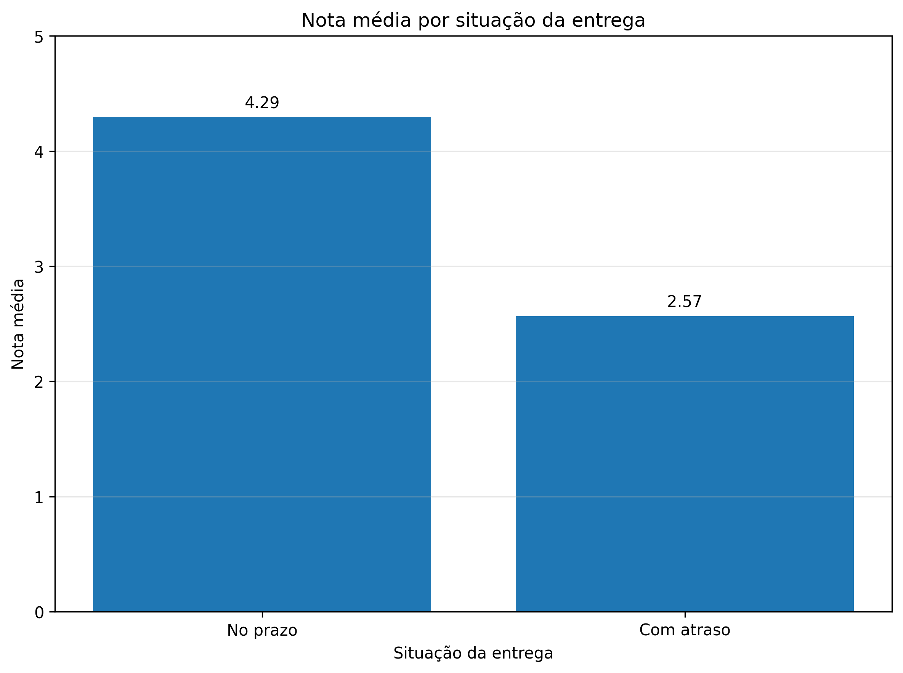
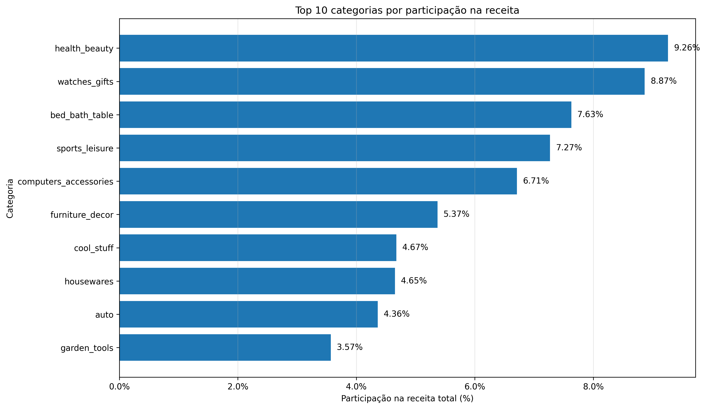
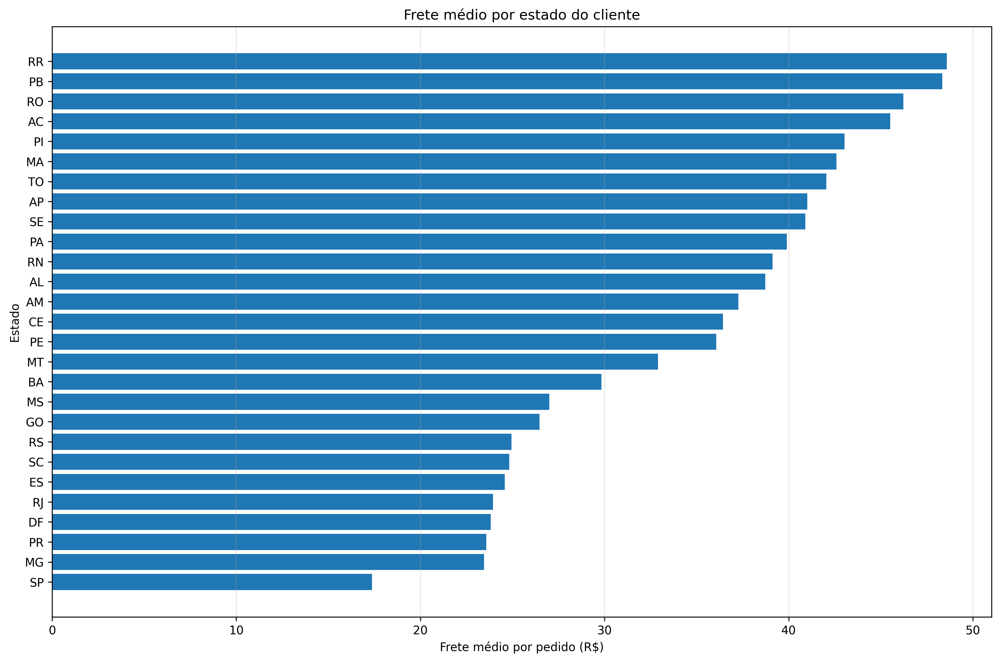
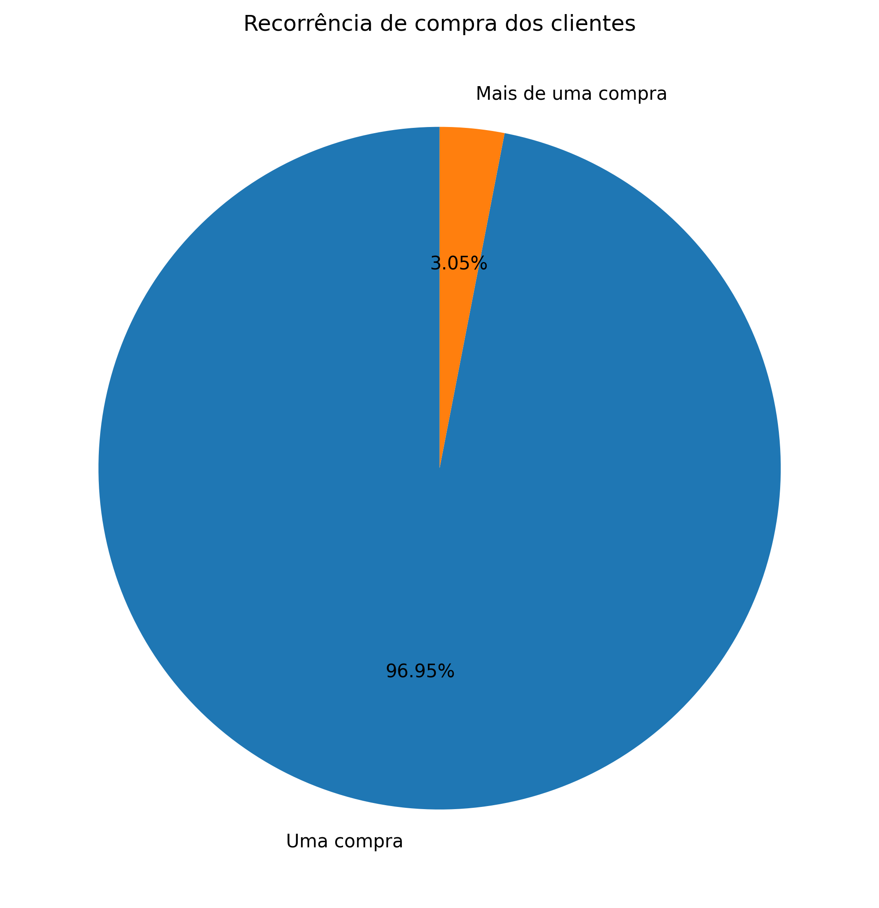
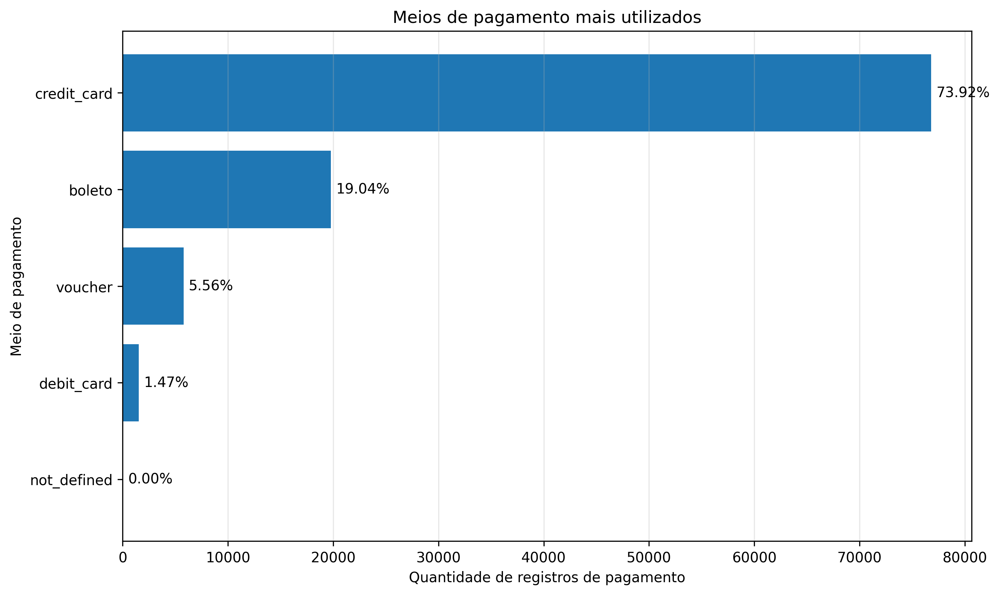

# Análise Exploratória de Dados — E-commerce Olist

## Objetivo

Esta análise exploratória tem como objetivo investigar aspectos comerciais, logísticos, financeiros e comportamentais da operação de e-commerce da Olist, utilizando as tabelas da camada Gold do Data Warehouse.

Foram analisadas cinco áreas: vendas, logística, satisfação do cliente, financeiro, clientes e pagamentos. Para cada área, foram definidas duas perguntas de negócio, respondidas por meio de consultas SQL e visualizações.

---

# 1. Vendas

## 1.1. Quais são as 10 categorias com maior receita?

A categoria Health & Beauty lidera o ranking, com R$ 1,26 milhão em receita, seguida por Watches & Gifts (R$ 1,21 milhão) e Bed Bath Table (R$ 1,04 milhão). As três categorias ultrapassam R$ 1 milhão em receita de produtos.

## 1.2. Como a receita total varia mês a mês?

A receita apresentou crescimento expressivo ao longo de 2017, atingindo seu pico em novembro, com R$ 1,007 milhão. Em 2018, manteve-se próxima de R$ 1 milhão entre março e maio, seguida de uma redução moderada até agosto.

### Critérios da análise

- Fonte: `olist_dw.dw.fact_sales` e `olist_dw.dw.dim_product`.
- Receita considerada: soma do campo `price`, sem incluir o frete.
- Período do gráfico mensal: janeiro de 2017 a agosto de 2018.
- Meses com baixa representatividade foram identificados durante a validação da cobertura temporal e excluídos do gráfico principal.

---

# 2. Logística

## 2.1. Qual o tempo médio de entrega, em dias, por estado?

Roraima apresenta o maior tempo médio de entrega, com 29,41 dias, enquanto São Paulo apresenta o menor, com 8,72 dias. A diferença evidencia uma variação relevante no prazo de entrega entre os estados. Os resultados de estados com menor quantidade de pedidos devem ser interpretados com cautela.

## 2.2. Qual a porcentagem de pedidos entregues com atraso?

Dos 96.470 pedidos entregues com datas válidas para comparação, 7.826 foram entregues após a data estimada, representando 8,11% do total. Os outros 91,89% foram entregues dentro do prazo estimado.

### Critérios da análise

- Fonte: `olist_dw.dw.fact_delivery_metrics` e `olist_dw.dw.dim_customer`.
- Tempo médio calculado pela diferença entre a data de compra e a data de entrega ao cliente.
- Foram considerados pedidos com status `delivered` e datas de entrega válidas.
- Um pedido foi classificado como atrasado quando a data efetiva de entrega foi posterior à data estimada.

---

# 3. Satisfação do Cliente

## 3.1. Como se distribuem as notas de 1 a 5?

A distribuição das avaliações é predominantemente positiva: 57,78% dos clientes atribuíram nota 5 e 19,29% atribuíram nota 4. Entretanto, 14,69% das avaliações foram notas 1 ou 2, indicando oportunidades de melhoria na experiência do cliente.

## 3.2. Pedidos atrasados têm nota média menor que os entregues no prazo?

Sim. Pedidos entregues com atraso apresentam nota média de 2,57, enquanto os entregues no prazo alcançam 4,29. A diferença de 1,72 ponto evidencia uma forte associação entre atrasos na entrega e menor satisfação dos clientes.

### Critérios da análise

- Fonte: `olist_dw.dw.order_reviews` e `olist_dw.dw.fact_delivery_metrics`.
- Foram consideradas avaliações com notas entre 1 e 5.
- As avaliações foram agrupadas por pedido para calcular a nota média de cada pedido.
- A comparação considerou pedidos entregues com datas válidas e avaliações associadas.
- A diferença observada indica associação entre atraso e avaliação, mas não comprova causalidade.

---

# 4. Financeiro

## 4.1. Qual a receita por categoria e sua participação no total?

Health & Beauty lidera a receita, com R$ 1,26 milhão (9,26% do total), seguida por Watches & Gifts, com R$ 1,21 milhão (8,87%). As três principais categorias concentram 25,76% da receita de produtos.

## 4.2. Qual o valor médio do frete por estado do cliente?

Roraima apresenta o maior frete médio por pedido, com R$ 48,59, seguido pela Paraíba, com R$ 48,35. São Paulo apresenta o menor valor médio, de R$ 17,37. Os resultados também demonstram diferenças regionais relevantes no custo de frete.

### Critérios da análise

- Fonte: `olist_dw.dw.fact_sales` e `olist_dw.dw.dim_product` para receita por categoria; `olist_dw.dw.fact_sales` e `olist_dw.dw.dim_customer` para frete por estado.
- Receita calculada pela soma do campo `price`, sem incluir o frete.
- Participação percentual calculada sobre a receita total de todas as categorias, incluindo registros sem categoria identificada.
- Para o frete médio, os valores de `freight_value` foram somados por pedido antes do cálculo da média por estado, evitando tratar cada item como um pedido independente.

---

# 5. Clientes e Pagamentos

## 5.1. Qual a porcentagem de clientes que compraram mais de uma vez?

Apenas 3,05% dos 95.420 clientes compradores realizaram mais de uma compra, enquanto 96,95% compraram uma única vez. O resultado indica baixa recorrência de compras na base analisada.

## 5.2. Quais os meios de pagamento mais usados?

O cartão de crédito é o meio de pagamento predominante, representando 73,92% dos registros, seguido pelo boleto, com 19,04%. Juntos, esses meios concentram 92,96% dos registros de pagamento.

### Critérios da análise

- Fonte: `olist_dw.dw.fact_sales`, `olist_dw.dw.dim_customer` e `olist_dw.dw.fact_payments`.
- Para identificar clientes recorrentes, foi utilizado o identificador `customer_unique_id`, contando pedidos distintos por cliente.
- A análise de recorrência considera clientes com pedidos representados na tabela `fact_sales`.
- Para os meios de pagamento, cada registro da `fact_payments` foi considerado um pagamento.
- Um mesmo pedido pode apresentar mais de um registro de pagamento ou modalidade; portanto, os percentuais representam a participação sobre os registros de pagamento, e não sobre pedidos exclusivos.

---

# Considerações Finais

A análise identificou concentração de receita em determinadas categorias, diferenças relevantes nos prazos e custos de entrega entre estados e uma associação expressiva entre atrasos e avaliações negativas.

Também foi observada baixa recorrência de compras, enquanto o cartão de crédito se destacou como principal meio de pagamento.

Os resultados demonstram oportunidades de investigação em estratégias de retenção de clientes, eficiência logística e melhoria da experiência de compra.