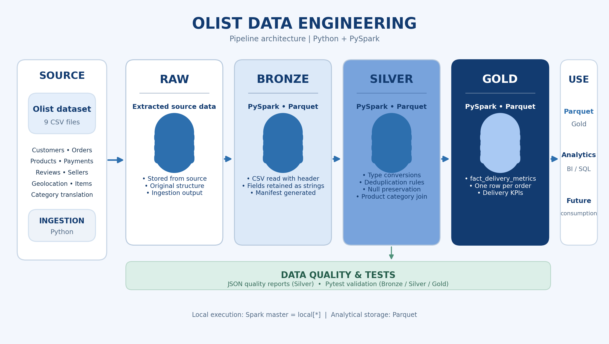

# Architecture – Olist Data Engineering

## 1. Visão geral

Este projeto implementa um pipeline de Engenharia de Dados utilizando o dataset público da Olist, com o objetivo de realizar a ingestão, transformação, tratamento e disponibilização dos dados para análises.

A solução utiliza uma arquitetura em camadas, baseada no conceito de Medallion Architecture, organizada em RAW, Bronze, Silver e Gold.

O processamento das transformações foi desenvolvido utilizando Python e PySpark, com armazenamento dos dados em formato Parquet nas camadas analíticas.

A arquitetura foi projetada para separar as responsabilidades de cada etapa, facilitar a manutenção do pipeline e permitir a evolução das transformações de forma organizada.

## 2. Arquitetura do pipeline

O fluxo de processamento segue a seguinte estrutura:



### Fluxo de processamento

1. **Source:** arquivos CSV disponibilizados pelo dataset Olist.
2. **RAW:** ingestão e armazenamento dos dados extraídos da origem.
3. **Bronze:** leitura dos arquivos e persistência em Parquet, mantendo os valores originais como strings.
4. **Silver:** conversões de tipos, tratamento de duplicidades, preservação de valores nulos e enriquecimento dos dados.
5. **Gold:** construção de tabelas analíticas e métricas de negócio.
6. **Quality Reports:** geração de relatórios JSON com indicadores de qualidade da camada Silver.
7. **Testing:** validação das transformações por meio de testes automatizados com Pytest.

## 3. Tecnologias utilizadas

| Tecnologia | Aplicação |
|---|---|
| Python | Linguagem principal do projeto e ingestão |
| PySpark | Processamento distribuído e transformações de dados |
| Apache Spark | Engine de processamento |
| Parquet | Formato de armazenamento das camadas analíticas |
| JSON | Armazenamento dos relatórios de qualidade |
| Pytest | Testes automatizados |
| Git | Controle de versão |

O processamento Spark está configurado para execução local, utilizando o modo `local[*]`, que permite aproveitar os processadores disponíveis na máquina durante o desenvolvimento.

## 4. Organização das camadas

### 4.1. Source

Contém os arquivos CSV originais disponibilizados pelo dataset público da Olist.

São nove arquivos:

- olist_customers_dataset.csv
- olist_geolocation_dataset.csv
- olist_orders_dataset.csv
- olist_order_items_dataset.csv
- olist_order_payments_dataset.csv
- olist_order_reviews_dataset.csv
- olist_products_dataset.csv
- olist_sellers_dataset.csv
- product_category_name_translation.csv

### 4.2. RAW

Responsável pela ingestão dos arquivos de origem.

Nesta etapa, os dados são extraídos e armazenados para utilização nas etapas seguintes, preservando a estrutura original dos arquivos.

A ingestão é implementada utilizando Python.

### 4.3. Bronze

Responsável pela primeira etapa de processamento dos dados.

As principais operações são:

- Leitura dos arquivos CSV.
- Processamento utilizando PySpark.
- Preservação dos campos originais como strings.
- Persistência dos dados em formato Parquet.
- Geração de manifesto com informações da ingestão.

A camada Bronze mantém os dados próximos da estrutura original, servindo como base para as transformações seguintes.

### 4.4. Silver

Responsável pelo tratamento, padronização e enriquecimento dos dados.

As principais operações são:

- Conversão de datas para Timestamp.
- Conversão de campos numéricos para Double.
- Conversão de campos inteiros para Long.
- Identificação e remoção de duplicidades conforme as chaves definidas.
- Preservação de registros com chaves incompletas.
- Preservação de valores nulos.
- Tradução das categorias dos produtos.
- Geração de relatórios de qualidade.

Os dados tratados são persistidos em formato Parquet.

Os relatórios de qualidade são armazenados em `data/silver/quality_reports/`, no formato JSON.

### 4.5. Gold

Responsável pela construção de dados analíticos a partir das tabelas tratadas na camada Silver.

Nesta versão, foi implementada a tabela:

**`fact_delivery_metrics`**

A tabela possui granularidade de um registro por pedido (`order_id`) e contém métricas relacionadas ao desempenho das entregas.

Principais indicadores:

- Tempo efetivo de entrega.
- Prazo estimado de entrega.
- Variação entre a data efetiva e a estimada.
- Quantidade de dias de atraso.
- Indicador de entrega no prazo.
- Classificação do desempenho da entrega.

Os resultados são armazenados em formato Parquet.

## 5. Organização dos diretórios

A estrutura principal do projeto está organizada da seguinte forma:

```text
teste-tecnico-bemol-olist/
│
├── data/
│   ├── source/
│   ├── raw/
│   ├── bronze/
│   ├── silver/
│   │   └── quality_reports/
│   └── gold/
│       └── fact_delivery_metrics/
│
├── src/
│   ├── ingestion/
│   ├── bronze/
│   ├── silver/
│   ├── gold/
│   ├── spark/
│   └── config/
│
├── tests/
│   ├── scripts_diagnostics/
│   ├── test_silver.py
│   ├── test_gold.py
│   └── test_translation.py
│
├── docs/
│   ├── architecture.md
│   ├── data_dictionary.md
│   └── data_quality.md
│
├── requirements.txt
├── pytest.ini
├── .gitignore
└── README.md
```

Cada diretório possui uma responsabilidade específica, mantendo separadas as etapas de ingestão, processamento, validação e documentação.

## 6. Testes e validação

O projeto utiliza Pytest para validar as principais regras implementadas nas transformações.

Os testes estão organizados em módulos:

| Arquivo | Responsabilidade |
|---|---|
| test_silver.py | Validação de conversões de tipos, duplicidades e valores nulos |
| test_translation.py | Validação da tradução das categorias de produtos |
| test_gold.py | Validação das métricas e classificações de entrega |

Os testes utilizam dados controlados para verificar os resultados esperados das transformações.

Para executar os testes:

```bash
pytest tests/ -v
```

## 7. Armazenamento e formatos

O projeto utiliza formatos diferentes conforme a finalidade de cada etapa:

| Camada | Formato | Finalidade |
|---|---|---|
| Source | CSV | Dados originais |
| RAW | Conforme implementação de ingestão | Dados extraídos |
| Bronze | Parquet | Persistência dos dados de origem |
| Silver | Parquet | Dados tratados e enriquecidos |
| Gold | Parquet | Dados analíticos |
| Quality Reports | JSON | Indicadores de qualidade |

O formato Parquet foi utilizado nas camadas analíticas por ser um formato colunar, adequado ao processamento e à leitura de dados com Apache Spark.

## 8. Considerações sobre a arquitetura

A arquitetura foi desenvolvida com separação de responsabilidades entre as etapas de processamento.

Essa organização permite:

- Reprocessar etapas de forma independente.
- Manter os dados originais disponíveis nas camadas iniciais.
- Centralizar regras de tratamento na camada Silver.
- Disponibilizar dados preparados para análise na camada Gold.
- Monitorar indicadores de qualidade.
- Validar regras de transformação por meio de testes automatizados.

A implementação atual utiliza execução local com PySpark. A arquitetura em camadas permite evoluções futuras para ambientes de processamento em nuvem e maior volume de dados, sem exigir que todas as regras de negócio sejam reimplementadas.

---

## Documentação complementar

Para aprofundar o entendimento da plataforma de dados, consulte também:

- [Modelo Dimensional](dimensional_model.md) — apresenta a estrutura do Data Warehouse, suas dimensões e tabelas fato.
- [Dicionário de Dados](data_dictionary.md) — detalha as tabelas, colunas, tipos de dados e descrições.
- [Qualidade dos Dados](data_quality.md) — apresenta as verificações e regras utilizadas para avaliar a qualidade dos dados.
- [Análise Exploratória](exploratory_data_analysis.md) — reúne as análises de negócio, consultas SQL e visualizações desenvolvidas.
