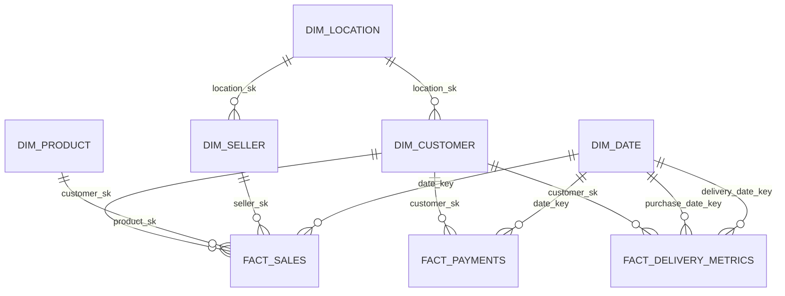

# Modelo Dimensional — E-commerce Olist

## 1. Visão geral

A camada Gold implementa um Data Warehouse dimensional para o conjunto de dados do e-commerce Olist, utilizando Databricks e Delta Lake.

O modelo foi desenvolvido para permitir análises relacionadas a vendas, pagamentos, clientes, produtos, vendedores e desempenho logístico.

O modelo dimensional é composto por cinco tabelas dimensão e três tabelas fato.

**Catálogo:** `olist_dw`  
**Schema:** `dw`

## 2. Modelo de dados

### Tabelas dimensão

| Tabela | Chave substituta (Surrogate Key) | Chave de negócio | Descrição |
|---|---|---|---|
| `dim_customer` | `customer_sk` | `customer_id` | Atributos dos clientes e referência geográfica |
| `dim_product` | `product_sk` | `product_id` | Atributos dos produtos e categorias |
| `dim_seller` | `seller_sk` | `seller_id` | Atributos dos vendedores e referência geográfica |
| `dim_location` | `location_sk` | `zip_code_prefix` | Informações geográficas por prefixo de CEP |
| `dim_date` | `date_key` | `full_date` | Atributos de calendário para análises temporais |

### Tabelas fato

| Tabela | Granularidade | Principais métricas |
|---|---|---|
| `fact_sales` | Um registro por item de pedido (`order_id` + `order_item_id`) | Preço do produto, valor do frete e valor total do item |
| `fact_payments` | Um registro por pagamento (`order_id` + `payment_sequential`) | Valor do pagamento e quantidade de parcelas |
| `fact_delivery_metrics` | Um registro por pedido (`order_id`) | Duração da entrega e dias de atraso |

## 3. Relacionamentos

As tabelas fato utilizam chaves substitutas para estabelecer seus relacionamentos com as dimensões.

- `fact_sales` relaciona-se com as dimensões de cliente, produto, vendedor e data da compra.
- `fact_payments` relaciona-se com as dimensões de cliente e data da compra.
- `fact_delivery_metrics` relaciona-se com as dimensões de cliente, data da compra e data de entrega.
- `dim_customer` e `dim_seller` possuem referência à `dim_location` por meio da coluna `location_sk`.

A dimensão geográfica está relacionada às dimensões de cliente e vendedor, e não diretamente às tabelas fato.

### Diagrama do modelo dimensional

## 4. Decisões de modelagem

### Chaves substitutas (Surrogate Keys)

Foram criadas chaves substitutas para as dimensões de clientes, produtos, vendedores e localização utilizando a função `ROW_NUMBER()`.

A dimensão de datas utiliza uma chave inteira no formato `yyyyMMdd`.

As chaves de negócio originais foram preservadas para garantir a rastreabilidade dos registros em relação aos dados de origem.

**Observação:** as chaves geradas por `ROW_NUMBER()` podem mudar caso as dimensões sejam reconstruídas. Em uma evolução do projeto com cargas incrementais, será necessário implementar uma estratégia de persistência das chaves substitutas.

### Dimensão geográfica

A tabela original de geolocalização possui múltiplos registros para um mesmo prefixo de CEP.

Para construir uma dimensão geográfica consistente, foram aplicadas as seguintes regras:

- Latitude e longitude calculadas por meio da média dos registros de cada CEP.
- Cidade e estado selecionados com base na combinação de maior frequência.
- A coluna `geolocation_count` registra a quantidade de observações de origem por prefixo de CEP.
- Cada prefixo de CEP possui apenas um registro na dimensão.

Clientes e vendedores cujos CEPs não possuem correspondência na tabela de geolocalização foram preservados com `location_sk` nulo.

### Dimensão de datas

A dimensão calendário contempla o período de 5 de setembro de 2016 a 12 de novembro de 2018.

Inclui atributos para análises temporais, como:

- Ano.
- Trimestre.
- Mês e nome do mês.
- Semana do ano.
- Dia do mês.
- Dia da semana e nome do dia.
- Indicador de final de semana.
- Ano e mês.

### Granularidade das tabelas fato

Cada tabela fato possui uma granularidade específica. Por isso, elas não devem ser relacionadas diretamente sem uma agregação prévia para níveis de detalhe compatíveis.

Junções diretas entre fatos de granularidades diferentes podem multiplicar registros e provocar duplicidade na contabilização de métricas.

As granularidades definidas são:

- **Vendas:** um registro por item de pedido.
- **Pagamentos:** um registro por transação de pagamento.
- **Entregas:** um registro por pedido.

## 5. Métricas de negócio

O modelo Gold permite desenvolver análises relacionadas a:

- Valor total de vendas e frete.
- Vendas por produto e categoria.
- Desempenho de vendas por cliente e vendedor.
- Valores de pagamento por tipo de pagamento e quantidade de parcelas.
- Quantidade de pedidos e itens vendidos.
- Tempo médio de entrega.
- Percentual de entregas realizadas no prazo.
- Volume de entregas atrasadas.
- Desempenho logístico ao longo do tempo.

## 6. Regras de classificação das entregas

A coluna `delivery_status`, presente na tabela `fact_delivery_metrics`, utiliza as seguintes regras:

| Classificação | Regra de negócio |
|---|---|
| `delivered_on_time` | Pedido entregue até a data estimada de entrega |
| `delivered_delayed` | Pedido entregue após a data estimada de entrega |
| `delivery_data_inconsistent` | Pedido com status de entregue, mas sem data efetiva de entrega |
| `canceled` | Pedido com status de cancelado |
| `not_delivered` | Demais pedidos que ainda não foram entregues |

As métricas de duração da entrega utilizam diferenças entre datas-calendário, calculadas por meio da função `DATEDIFF()`.

## 7. Volumetria atual das tabelas

Os volumes identificados após a construção do modelo dimensional são:

| Tabela | Registros |
|---|---:|
| `dim_customer` | 99.441 |
| `dim_product` | 32.951 |
| `dim_seller` | 3.095 |
| `dim_location` | 19.015 |
| `dim_date` | 799 |
| `fact_sales` | 112.650 |
| `fact_payments` | 103.886 |
| `fact_delivery_metrics` | 99.441 |

## 8. Tecnologias utilizadas

- Databricks
- Apache Spark / PySpark
- Delta Lake
- Unity Catalog
- SQL
- Python

## 9. Considerações sobre qualidade dos dados

O modelo contempla validações de volumetria, granularidade, unicidade de chaves de negócio, integridade referencial e classificação das entregas.

Durante a construção e validação, foram identificadas as seguintes ocorrências:

- 278 clientes e 7 vendedores sem correspondência de CEP na dimensão geográfica.
- Um pedido com status de entregue sem registro correspondente na tabela de pagamentos.
- Oito pedidos com status de entregue sem data efetiva de entrega.
- Diferenças entre os totais financeiros de vendas e pagamentos, que ainda necessitam de conciliação.

As ocorrências identificadas foram preservadas e documentadas, sem criação artificial de informações.

Para consultar os detalhes dos testes, resultados e exceções identificadas, acesse [Qualidade dos Dados](data_quality.md).